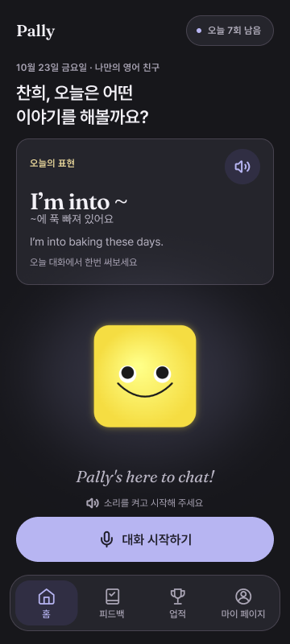
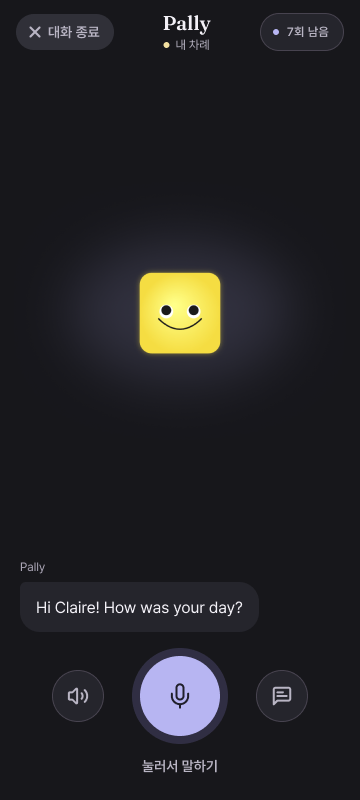
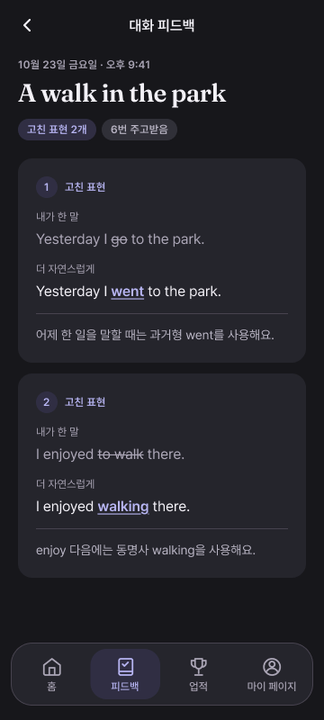

# Pally — CharaShift MVP


> **[English]** An AI English conversation partner whose personality shifts in real-time based on your speaking style.
> Five axes combine learned text-style models (Formality · Humor · Curiosity), access history (Intimacy), and within-speaker pitch-range change (Energy),
> passed through a **CHARACTER MATRIX** transform, and reflected instantly in Pally's shape, color, and tone.
>
> **Demo (mobile or F12 → mobile view on desktop):** [capstone-eight-virid.vercel.app/home](https://capstone-eight-virid.vercel.app/home) · [YouTube walkthrough](https://youtu.be/Ptlq6SM4C6g?si=ShOETKqPAWakxxjb)
>
> Stack: Next.js 14 · FastAPI · Google Cloud STT/TTS · Gemini 2.5 Flash · Supabase · Canvas2D Superformula
>
> *Full documentation below is in Korean (Ewha Womans University Capstone Design 2026, Team puter8).*

---

> 대화 진행에 따라 성격이 변하는 AI 캐릭터와의 정서적 유대감 기반 영어 회화 학습 지속 서비스

이화여대 캡스톤 디자인 (산학 트랙) · 팀명 **퓨터(puter8)** · 지도교수 심재형 · 2026-06-07 데모

---

## 데모 (Live)

> ⚠️ **데스크톱은 F12 → 모바일 뷰(~360px)로 열어주세요. 모바일 기기에서는 그냥 접속하면 됩니다.**

| Surface | URL | 상태 |
|---|---|---|
| 데모 영상 | https://youtu.be/Ptlq6SM4C6g?si=ShOETKqPAWakxxjb | YouTube |
| 서비스 (Vercel) | https://capstone-eight-virid.vercel.app/home | 접속 가능 |


### 스크린샷

| 홈 · 오늘의 표현 | 대화 화면 | 발화별 피드백 |
|:---:|:---:|:---:|
|  |  |  |

> 현재 UI의 [Figma 디자인 시안](https://www.figma.com/design/4kLxDLD2LdbB5BiY2QT5qU?node-id=1360-750)입니다. 홈의 오늘의 표현 카드, Pally와의 대화, 발화별 교정·대안 표현 화면을 보여줍니다. 시안 속 이름·날짜·대화는 예시입니다.

### 데모에서 확인할 수 있는 흐름

대화 시작 전 홈의 **오늘의 표현** 카드에서 표현·뜻·예문을 확인할 수 있습니다. 듣기 버튼을 누르면 예문 음성이 재생되고, 다시 누르면 중지됩니다.

1. 홈 화면에서 마이크 버튼(rec)을 누르면 브라우저 권한 요청 후 녹음 시작
2. 영어로 한 문장 말하기 → STT(Google Cloud) → Gemini 2.5 Flash 응답
3. 발화 텍스트가 5축으로 분석되고 → CHARACTER MATRIX 통과 → Pally 외형과 말투가 즉시 변함
4. 응답은 TTS로 자연 음성 재생, 화면 하단에는 한국어 인라인 힌트가 표시됨
5. 우상단 X로 세션 종료 시 누적 점수가 반영된 최종 Pally 모습을 공개

---

## 팀

| 이름 | 역할 |
|------|------|
| 최윤서 | PM · 기획 · QA |
| 백은혜 | BE · AI 파이프라인 (FastAPI · GCP STT/TTS · Gemini · Supabase) |
| 김민주 | AI 엔진 · Pally 렌더러 (5축 분석 · CHARACTER MATRIX · Canvas2D) |
| 이찬희 | FE · 디자인 (Next.js 14 · 메인/오디오 셸 · 디자인 시스템) |

---

## 문제와 솔루션 한 줄

- 해결하려는 문제: 기존 영어 회화 서비스는 사용자 말투와 대화 성향을 충분히 반영하지 못해 대화가 획일적으로 느껴질 수 있습니다.
- 기술 솔루션: 사용자 발화를 5개 축으로 수치화한 뒤, CHARACTER MATRIX 연산으로 AI 캐릭터 파라미터로 변환합니다. EMA 설정을 통해 Pally의 성격 변화율을 안정적으로 유지합니다.
- 기대 효과: 사용자 스타일이 반영되는 더 몰입감 있는 회화 경험을 제공하여 사용자가 향후 실제 AI 대화 시스템과 연결 가능한 핵심 엔진을 확보합니다.
- MVP 핵심기술: `사용자 발화 스타일 -> 5축 점수 -> CHARACTER MATRIX -> 캐릭터 반응 성격`

- **입력 5축**: `Formality` · `Energy` · `Intimacy` · `Humor` · `Curiosity`
- **출력 캐릭터 파라미터**: `tone_casual` · `energy_level` · `humor_level`
- **분석 구조**: 능동학습 기반 텍스트 3축(Formality·Humor·Curiosity) + 접속 이력 기반 Intimacy + 음성 억양 변화 기반 Energy → CHARACTER MATRIX·상태 누적 → 캐릭터 반응

영어 회화 학습 서비스는 보통 질문에 답하는 기능 자체는 제공하지만, 사용자의 말투와 친밀도, 에너지 수준, 질문 성향까지 세밀하게 반영하는 경우는 많지 않습니다. 그 결과 사용자는 "나에게 맞춘 대화"보다 "정해진 챗봇 응답"을 받는 느낌을 받기 쉽습니다.

자세한 설계 근거는 [`docs/mvp/2026-05-midterm-qa.md`](docs/mvp/2026-05-midterm-qa.md) 참고.

---

## 주요 기능

- **오늘의 표현 카드** — 홈에서 영어 표현·한국어 뜻·예문을 확인하고, Google Cloud TTS로 생성한 예문 음성을 재생·중지. 대화를 시작하거나 다른 화면으로 이동하면 재생 종료
- **음성 입력/출력** — 브라우저 마이크 → Google Cloud Speech-to-Text(EN) → Gemini 2.5 Flash → Google Cloud Text-to-Speech(EN) → 즉시 재생
- **3축 학습 모델 + 2축 관측 지표** — 텍스트의 공손성·유머·질문 참여는 학습 모델로, 친밀도는 누적 접속 일수로, 에너지는 개인 기준 대비 음성 억양 폭 변화로 산출
- **CHARACTER MATRIX 엔진** — 서로 다른 입력으로 얻은 축 점수를 캐릭터 파라미터로 변환하고, 누적 상태에 반영
- **Pally 실시간 변형** — Canvas2D Superformula 도형이 형태·색·표정으로 5축 변화를 시각화
- **자연스러운 문법 교정** — Gemini가 사용자의 문법/어휘 실수를 직접 지적하지 않고 올바른 표현을 자연스럽게 사용해 응답
- **세션 종료 컷신** — X 버튼으로 세션 종료 시 누적된 변화가 적용된 최종 Pally를 공개
- **익명 세션** — Supabase `sessions` / `messages` 테이블에 세션 ID 기반으로 모든 턴·5축·캐릭터 파라미터를 JSONB로 저장. RLS는 `session_id` 기준

## 기술 솔루션

> **최근 반영 — 2026-11-03 · [PR #139](https://github.com/puter8/capstone/pull/139)**
> 오늘의 표현 카드는 현재 고정 예시 `I’m into ~`(“~에 푹 빠져 있어요”)와 `I’m into baking these days.`를 제공합니다. 매일 자동 변경·레벨별 선정·사용 여부 판정은 아직 구현하지 않았습니다.

현재 모델의 핵심은 `CHARACTER MATRIX 엔진`입니다.

---

1. 음성에서 전사 텍스트와 억양 특징을 얻고, 사용자 접속 이력을 함께 조회합니다.
2. 학습한 텍스트 모델이 Formality·Humor·Curiosity 3축을 예측합니다.
3. Intimacy는 누적 접속 일수, Energy는 개인 기준 음성 대비 억양 폭 변화로 계산합니다.
4. CHARACTER MATRIX와 상태 누적 로직이 축 점수를 캐릭터 파라미터로 연결합니다.
5. Pally의 외형 변화와 대화·피드백으로 결과를 제공합니다.

### 데이터 규모와 모델 개발 과정

초기 소규모 예문과 규칙 기반 분석에서 출발해, **실제 영어 발화 코퍼스와 능동학습을 활용한 3축 모델**로 발전시켰습니다. 데이터의 확보 규모, 자동 라벨 확장 실험 규모, 최종 모델의 사람 라벨 학습 규모를 구분합니다.

| 단계 | 데이터 규모 | 활용 방식 |
|---|---:|---|
| 실제 발화 확보 | **543,658개 · 7개 코퍼스** | NICT JLE·AMI·CHiME-6·HCRC Map Task·ICSI·Santa Barbara·Taskmaster-1에서 학습자 인터뷰·일상·회의·과업 대화 수집 |
| 확장 실험 대상 | **238,475개 고유 발화** | 평가용 대화 그룹 보호와 중복 처리를 거쳐 자동 라벨링·의사 라벨 기반 확장 학습 실험에 활용 |
| 사람 라벨 학습 | **118개 발화 · 55개 대화 그룹** | 최종 선택된 3축 모델의 학습·그룹 교차검증에 사용. 부분 라벨을 허용해 유효 라벨 수는 Formality 110개, Humor 118개, Curiosity 113개 |
| 개발 평가 | **35개 발화** | 학습과 분리한 개발 자료. 유효 라벨은 Formality 30개, Humor 35개, Curiosity 30개 |
| 능동학습 추가 선정 | **50개 후보** | 학습 자료의 교차검증 오차와 모델 불일치 등을 바탕으로 보완할 사례를 선정. 24개 이중 AI 검수, 축별 합의 조건을 통과한 21개를 보완 실험에 활용 |

**개발 흐름**은 `실제 발화 정제 → rubric에 따른 라벨링 → 기준 모델 학습 → 오차·불일치 사례 우선 선정 → 검수·보완 실험 → 재학습·축별 모델 선택`입니다. 자동 라벨과 AI 검수는 사람 정답과 구분하며, 최종 선택 모델은 사람 라벨 118개로 학습했습니다. 238,475개 전체를 사람이 라벨링했거나 최종 모델이 모두 학습한 것으로 표현하지 않습니다.

단어·문자 단위 TF-IDF, 문장 임베딩, 두 특징의 결합을 비교하고 Ridge 회귀와 SVR을 축별로 선택했습니다. 같은 대화의 발화가 학습과 검증에 섞이지 않도록 그룹 단위 교차검증과 중첩 교차검증을 사용했습니다.

| 텍스트 축 | 선택한 모델 | 분석 초점 |
|---|---|---|
| **Formality** | 단어·문자 TF-IDF + Ridge | 발화에 드러나는 공손성·격식 |
| **Humor** | TF-IDF + 문장 임베딩 결합 + Ridge | 유머·장난스러운 표현의 사용 |
| **Curiosity** | 문장 임베딩 + 선형 SVR | 질문·확인·설명 요청을 통한 대화 참여 |

3축 추론 모델과 저장·로드 가능한 모델 아티팩트를 구현했습니다. 개발 자료를 반복 활용했으므로 이를 독립 최종 평가 성능으로 주장하지 않으며, 고유 발화 수는 확장 실험 규모를 뜻합니다. 모델 구성은 [`ai/selected_fhc_model.py`](ai/selected_fhc_model.py), 로딩 경로는 [`ai/researched_axis_model.py`](ai/researched_axis_model.py)를 참고하세요.

위 내용은 모델 개발 결과입니다. 텍스트 분석기의 실행 경로는 `PALLY_AXIS_ANALYZER` 설정으로 선택하며, 코드 기본값은 `rule`, 학습 모델 경로는 `researched`입니다. 운영 적용 여부는 실행 환경 설정과 구분해 확인합니다.

### 나머지 2축: 방문 이력과 개인별 억양 변화

| 축 | 실제 입력 | 계산 방식 |
|---|---|---|
| **Intimacy · 관계 친숙도** | KST 기준 누적 접속 일수 | 같은 날 새로고침·재접속은 중복 집계하지 않음. `100 × 접속 일수 / (접속 일수 + 10)`으로 증가 폭이 완만해지도록 계산하고 5점 단위로 반올림 |
| **Energy · 음성 표현성** | 개인 기준 음성과 현재 대화의 피치 범위 | pYIN으로 기본주파수(F0)를 추출하고 반음 단위 억양 폭의 80–20백분위 차이를 측정. 기준 녹음 3개의 중앙값과 세션 유효 녹음 5개 이상의 중앙값 차이를 점수로 변환 |

친밀도는 **얼마나 자주 Pally를 찾아왔는지**, 에너지는 **자신의 평소 목소리보다 억양 변화가 얼마나 커졌는지**를 반영합니다. Energy는 `50 + 10 × 억양 폭 변화량(반음)`을 0–100으로 제한하고 5점 단위로 반올림합니다. 기준 음성이나 유효 녹음이 부족하면 측정 불가로 처리하며, 텍스트로 음성 점수를 대체하지 않습니다. 감정 진단이나 사람 간 목소리의 절대 비교를 위한 지표는 아닙니다.

구현: [`ai/intimacy.py`](ai/intimacy.py) · [`ai/voice_energy.py`](ai/voice_energy.py).

### 최종 MVP 소프트웨어는 무엇인가

이 프로젝트의 최종 MVP는 사용자가 영어 문장을 입력하면, 시스템이 그 발화 스타일을 분석하고 이에 맞춰 AI 캐릭터의 반응 성격이 달라지는 `웹 기반 영어 회화 프로토타입`입니다.

예를 들어,

- 캐주얼하고 친한 말투를 사용하면 더 편하고 친근한 캐릭터 반응이 나옵니다.
- 격식 있는 문장을 쓰면 더 정중하고 차분한 반응이 나옵니다.
- 질문이 많은 발화는 탐구형 대화로 이어질 가능성이 높아집니다.
- 유머 성향이 높은 발화는 더 가볍고 장난기 있는 반응으로 연결될 수 있습니다.
- 자연스럽게 사용자의 실수를 교정하도록 AI 대화방식을 설정하여 학습에 필요한 피드백을 받을 수 있습니다.

### 입력 5축

- `Formality`: 격식도
- `Energy`: 개인 기준 대비 음성 억양 폭 변화
- `Intimacy`: 누적 접속 일수 기반 관계 친숙도
- `Humor`: 유머 성향
- `Curiosity`: 탐구 성향

### 출력 캐릭터 파라미터

- `tone_casual`: 캐주얼한 말투 정도
- `energy_level`: 응답의 활발함
- `humor_level`: 유머러스한 반응 정도

## 왜 이 기술이 핵심기술인가

이 프로젝트의 고유핵심기술은 특정 외부 AI 모델 호출이 아니라, `사용자 발화 스타일을 구조화된 수치로 바꾸고 다시 캐릭터 성격으로 변환하는 로직`입니다.

- 단순한 프롬프트 엔지니어링이 아니라, 입력과 출력 사이에 자체 설계한 변환 구조가 있습니다.
- 사용자의 발화 특징이 어떤 방식으로 결과에 반영되는지 설명하기 쉽습니다.
- 테스트 코드로 실제 실행 과정을 직접 보여줄 수 있습니다.
- 향후 LLM, UI, 시각 캐릭터 시스템과 연결해도 중심 엔진으로 유지될 수 있습니다.

## 기대 성과와 사용자 효능

- 사용자 말투가 반영된 응답을 받아 더 개인화된 회화 경험을 느낄 수 있습니다.
- 고정형 챗봇보다 덜 딱딱하고 더 몰입감 있는 상호작용이 가능합니다.
- 향후 학습 피드백, 캐릭터 시각화, 장기 사용자 상태 저장과 연결하면 더 확장성 있는 회화 학습 시스템으로 발전할 수 있습니다.

## 현재 저장소에서 구현된 범위

### 현재 구현됨

**AI 엔진 (`ai/`)**
- 능동학습·검수·모델 비교를 거쳐 개발한 Formality·Humor·Curiosity 3축 학습 모델 (`selected_fhc_model.py`, `researched_axis_model.py`)
- 누적 접속 일수 기반 Intimacy 계산 (`intimacy.py`)
- 개인 기준 음성 대비 억양 폭 변화 기반 Energy 측정 (`voice_energy.py`)
- CHARACTER MATRIX 가중합 + EMA 보정 (`matrix_engine.py`)
- 규칙 기반 분석기와 초기 seed 예문은 비교 기준·회귀 확인용으로 보존 (`analyzer.py`, `data/dataset.py`)
- 초기 규칙·행렬 파이프라인 데모 스크립트 (`tests/test_matrix.py`)
- CHARACTER MATRIX 시각화 HTML 프로토타입 (`assets/visualizer.html`)

**Backend (`backend/`, FastAPI · Railway 배포 중)**
- `POST /api/stt` — Google Cloud Speech-to-Text 실호출 (영어)
- `POST /api/chat` — 5축 분석 + Gemini 2.5 Flash 응답 + 인라인 한국어 힌트(structured payload) + 캐릭터 파라미터
- `POST /api/tts` — Google Cloud Text-to-Speech 실호출 (base64 오디오)
- `POST /api/feedback` — 발화 표현 교정 / 대안 표현
- `GET /api/health` — 헬스 체크
- Supabase service-role 클라이언트로 `sessions` / `messages` 테이블에 모든 턴 영속화

**Frontend (`frontend/`, Next.js 14 App Router · Vercel 배포 중)**

- 오늘의 표현 카드 — 홈의 인사 아래에 표현·뜻·예문 표시, 앱에 포함된 MP3 재생·중지 및 재생 실패 안내
- 모바일 홈 배치 — 320/360/390px에서 카드·Pally·시작 버튼·하단 메뉴 배치 확인 (PR #139 검증 기록)
- 메인 홈 화면 (rec 버튼 · 채팅 영역 · 인라인 한국어 힌트) — 모바일 폭 ~360px 최적화
- 브라우저 마이크 녹음 → `/api/stt` → `/api/chat` → `/api/tts` 자동 재생 E2E 연결
- Canvas2D Superformula Pally 렌더러 (5축 → 형태·색·표정 변형)
- Listening / Thinking UI 상태, ChatBubble + LongBubble (X 닫기 포함)
- 세션 종료 컷신 — 우상단 X로 누적 변화 반영된 최종 Pally 공개
- GNB 라우팅 (home · history · my · ranking) + `/dev/pally` 렌더러 테스트 화면
- Supabase anon 클라이언트, Zod boundary 검증

**Database (`supabase/migrations/`)**
- `sessions` / `messages` 테이블 forward-only 마이그레이션
- `session_id` 기반 RLS 정책 (익명 세션)

**Infra**
- Frontend: `main` push → GitHub Actions `Deploy frontend` → Vercel production 배포
- Backend: Railway Git 연동 자동 배포
- PR #139 운영 배포 후 360px 홈에서 카드 표시·실제 예문 음성 재생·중지 확인 (2026-11-03, PR 검증 기록 기준)

### 향후 확장 예정

- 오늘의 표현 카드의 매일 자동 변경·레벨별 선정·사용 여부 판정
- 능동학습으로 부족한 표현·점수 구간의 라벨 보강 및 독립 최종 평가
- 사용자별 장기 상태 저장 (Supabase pgvector)
- 슬랭 RAG 파이프라인 (Reddit PRAW)
- 학습 효과 추적 / 사용자 인증


## 폴더 구조

```text
capstone/
├─ frontend/                  Next.js 14 App Router 앱 (Vercel)
│  ├─ app/
│  │  ├─ home/                메인 화면 (rec 버튼 · Pally · 인라인 힌트)
│  │  ├─ history/             대화 기록
│  │  ├─ my/                  마이페이지
│  │  ├─ ranking/             랭킹
│  │  ├─ dev/                 개발용 화면 (Pally 렌더러 테스트 등)
│  │  └─ api/health/          FE 헬스 라우트
│  ├─ components/
│  │  ├─ audio/               TalkButton, 녹음 상태 UI
│  │  ├─ chat/                ChatBubble, MessageRow
│  │  ├─ pally/               Canvas2D Superformula 렌더러
│  │  └─ v2/                  현재 UI 컴포넌트 (DailyExpressionCard 등)
│  ├─ lib/                    타입(`Message`, `Session`), Supabase 클라이언트, mock transport
│  └─ .env.example
│
├─ backend/                   FastAPI 백엔드 (Railway)
│  ├─ main.py                 /api/stt · /api/chat · /api/tts · /api/feedback · /api/health
│  ├─ lib/supabase.py         service-role Supabase 클라이언트 (서버 전용)
│  ├─ Procfile · runtime.txt  Railway 배포 설정
│  └─ .env.example
│
├─ ai/                        AI 핵심 엔진 (FE/BE 모두에서 import)
│  ├─ selected_fhc_model.py   축별로 선택한 Formality·Humor·Curiosity 모델
│  ├─ researched_axis_model.py 학습 모델 아티팩트 로딩
│  ├─ intimacy.py             접속 일수 기반 관계 친숙도
│  ├─ voice_energy.py         개인 기준 대비 음성 억양 폭 변화
│  ├─ analyzer.py             비교 기준용 규칙 기반 분석기
│  └─ matrix_engine.py        CHARACTER MATRIX 가중합 + EMA 보정
│
├─ data/dataset.py            초기 seed 예문 (비교·회귀 확인용)
├─ tests/test_matrix.py       엔진 전체 파이프라인 데모 스크립트
├─ assets/visualizer.html     CHARACTER MATRIX 시각화 프로토타입
│
├─ supabase/migrations/       sessions / messages 테이블 + RLS (forward-only)
│
├─ docs/
│  ├─ mvp/                    MVP 스펙 (PRD, 중간발표 Q&A)
│  ├─ final/                  전체 제품 기획 (Ideation, Implementation_Plan, Project Briefs 등)
│  ├─ shared/                 팀 그라운드 룰, 셋업 가이드, PMF 분석
│  ├─ plan/                   날짜별 plan 리뷰
│  ├─ adr/                    아키텍처 결정 기록
│  ├─ design/                 디자인 문서
│  └─ qa/                     데모 직전 QA 체크리스트
│
├─ .planning/                 gsd 워크플로 산출물 (PROJECT/REQUIREMENTS/ROADMAP/STATE + phases/)
├─ CLAUDE.md                  팀 + AI 에이전트 공용 가이드 (AGENTS.md symlink)
└─ DESIGN.md                  디자인 시스템 명세
```

---

## 기술 스택

| 영역 | 기술 |
|------|------|
| Frontend | Next.js 14 (App Router) · React 18 · TypeScript · Tailwind CSS · Canvas2D + Superformula |
| Backend | FastAPI · Python 3.11 · Pydantic v2 · httpx |
| AI | Google Cloud STT/TTS · Gemini 2.5 Flash · TF-IDF/문장 임베딩 + Ridge/SVR 3축 모델 · 접속 이력/음성 기반 2축 |
| Database | Supabase (PostgreSQL · Auth · RLS) |
| Infra | Vercel (FE, GitHub Actions) · Railway (BE, Git 연동) — `main` push로 자동 배포 |

---

## 로컬 실행(개발자용)

### 사전 준비

- Node.js 20+ / npm
- Python 3.11
- Supabase 프로젝트 (또는 팀 공유 ID 사용)
- Google Cloud API key (Speech-to-Text, Text-to-Speech) + Gemini API key (AI Studio)

자세한 키 발급/MCP 설정은 [`docs/shared/SETUP.md`](docs/shared/SETUP.md) 참고.

### 1) Frontend

```bash
cd frontend
cp .env.example .env.local
# .env.local 작성:
#   NEXT_PUBLIC_BACKEND_URL=http://localhost:8000
#   NEXT_PUBLIC_SUPABASE_URL=...
#   NEXT_PUBLIC_SUPABASE_ANON_KEY=...
npm install
npm run dev          # http://localhost:3000 → 자동 redirect /home
```

### 2) Backend

```bash
cd backend
cp .env.example .env
# .env 작성: GOOGLE_AI_API_KEY · GOOGLE_CLOUD_API_KEY · SUPABASE_URL · SUPABASE_SERVICE_ROLE_KEY
python -m venv .venv

# Mac / Linux
source .venv/bin/activate

# Windows
# .venv\Scripts\activate

pip install -r requirements.txt
uvicorn main:app --reload --port 8000
# 헬스 체크: curl http://localhost:8000/api/health → {"status":"ok"}
```

### 3) 엔진만 단독 실행 (백엔드/프론트 없이 빠르게 확인)

```bash
# 저장소 루트에서
python tests/test_matrix.py
```

입력 문장별 5축 결과와 캐릭터 파라미터가 콘솔에 출력됩니다. 시각화는 `assets/visualizer.html`을 브라우저로 열어 확인하세요.

---

## API 개요

Backend (`backend/main.py`) 가 노출하는 엔드포인트:

| Method · Path | 역할 |
|---|---|
| `GET /api/health` | 헬스 체크 |
| `POST /api/stt` | 녹음 오디오(`multipart/form-data`) → Google Cloud STT → 영어 텍스트 |
| `POST /api/chat` | 사용자 발화 텍스트 → 5축 분석 + Gemini 응답 + 인라인 한국어 힌트 + 캐릭터 파라미터 |
| `POST /api/tts` | 영어 응답 텍스트 → Google Cloud TTS → base64 오디오 |
| `POST /api/feedback` | 발화 1턴에 대한 표현 교정 / 대안 표현 |

상세 스키마는 [`backend/README_API.md`](backend/README_API.md) 참고.

---

## 엔진 실험 결과

현재 3축 모델은 TF-IDF·문장 임베딩 기반 후보를 축별로 비교하고, 사람 라벨 118개를 대상으로 그룹 교차검증·중첩 교차검증을 수행해 선택했습니다. 데이터 확장 실험과 최종 선택 모델의 학습 데이터는 위의 **데이터 규모와 모델 개발 과정**에서 구분했습니다.

`python tests/test_matrix.py`는 초기 규칙 기반 분석과 CHARACTER MATRIX의 연결을 확인하는 데모입니다. 현재 학습 모델의 정확도 평가와는 구분합니다.

---

## 한계와 향후 확장

- 능동학습으로 드문 유머·질문 참여 사례와 높은 점수 구간의 라벨을 보강하고, 별도 최종 평가 자료에서 일반화 성능을 확인할 예정
- 자동·의사 라벨은 사람 정답과 구분하며, 대규모 데이터 확장 자체를 성능 향상의 증거로 보지 않음
- Energy는 개인 기준 대비 억양 폭 변화 지표로, 녹음 품질·유성 구간 수와 개인 기준 음성 확보의 영향을 받음
- Intimacy는 접속 이력 기반 관계 상태로, 실제 정서적 친밀감이나 학습 성취도를 직접 측정하는 값은 아님
- 오늘의 표현 카드의 매일 자동 변경·레벨별 선정·사용 여부 판정 및 장기 학습 효과 검증은 향후 확장 범위

---
## 라이선스 / 문의

학내 캡스톤 산학 프로젝트 산출물. 외부 사용 문의는 팀 PM(최윤서, imyure@ewhain.net)으로.
